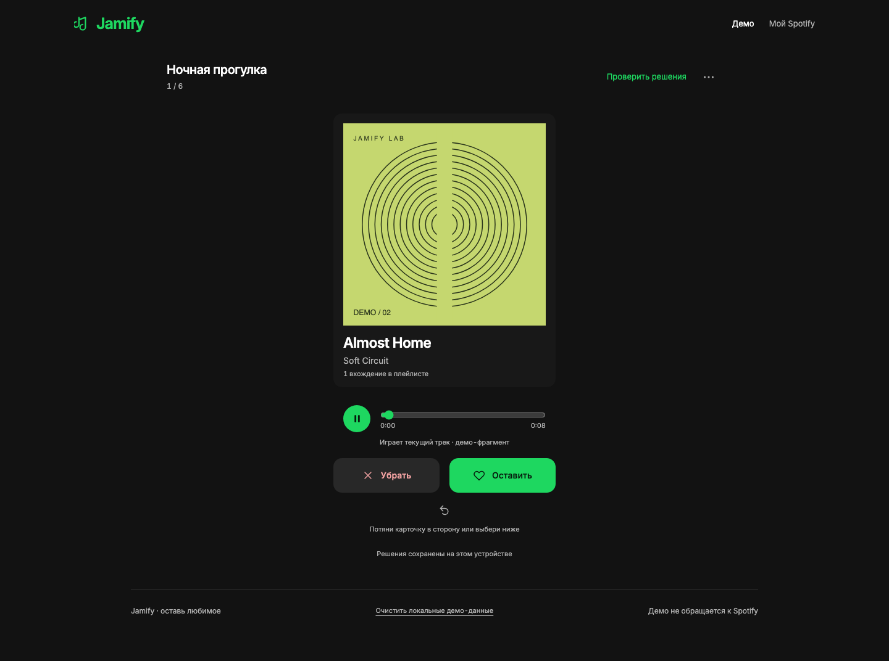

# Jamify

Переслушай плейлист. Свайп вправо — оставить, влево — убрать. Применение начинается после проверки решений.



В `/demo` работают музыка, свайпы, клавиатура, отмена, разбор всей очереди без остановки на25, восстановление после перезагрузки, удаление URI-групп и отдельная очищенная копия без точных дублей. Все данные и аудио в демо вымышлены; запросов Spotify нет.

**Настоящая медиатека открывается на `/`.** Можно загрузить свои/доступные совместные плейлисты и «Любимые треки», слушать через SDK, сохранять и скачивать решения. Старому входу могут понадобиться дополнительные разрешения чтения. Сохранённые чужие плейлисты видны; Spotify Development Mode ограничивает чтение их содержимого.

**Изменение реальных плейлистов пока на этапе технической пробы.** OAuth и SDK actual URI проверены в Safari. Удаление из тестового плейлиста осталось `unknown`; обычная уборка реальных плейлистов не включена. Автотесты не закрывают этот live gate. [Точное состояние](docs/STATUS.md), [живая проверка API](docs/API_CAPABILITIES.md).

## Попробовать локально

Нужен Node.js **22.13.x или 24+**. Последняя реализация находится в ночной ветке; `main` автоматически не объединялся.

```sh
git clone --branch codex/night-2026-11-01 https://github.com/Taveer09/Jamify.git
cd Jamify
npm ci
npm run dev
```

Открой [демо](http://127.0.0.1:5173/demo). Для него не нужны аккаунт, Client ID и `.env`.

1. Выбери вымышленный плейлист и прослушай текущий трек.
2. Свайпай или используй кнопки. Клавиши: ← убрать, → оставить, ↓ пропустить, Ctrl/Cmd+Z отменить. При невозможности включить звук есть явный режим без звука.
3. Открой «Проверить решения». Удаление убирает все вхождения выбранного URI и сохраняет порядок остальных записей.
4. Либо выбери «Создать копию без дублей»: первое вхождение каждого оставленного URI попадёт в новую приватную демо-копию; исходник сохранится. Непросмотренные треки тоже сохраняются.
5. После применения результат перечитывается. Неоднозначная запись останавливает операцию; перезагрузка сохраняет журнал для проверки, без автоматического повтора.

Локальные файлы, недоступные записи и неоднозначные URI сохраняются при удалении других групп. Если их нельзя без потерь перенести, создание копии блокируется с объяснением. Похожие издания автоматически не объединяются.

## Подключить Spotify для технической пробы

Обычному пользователю достаточно «Войти через Spotify». Владелец экземпляра настраивает Client ID один раз; создавать Developer App каждому пользователю не нужно.

Для самостоятельного запуска создай приложение в [Spotify Developer Dashboard](https://developer.spotify.com/dashboard), включи Web API/Web Playback SDK и зарегистрируй точный Redirect URI `http://127.0.0.1:5173/callback`. Скопируй `.env.example` в `.env.local`, если файла ещё нет, и задай публичный `VITE_SPOTIFY_CLIENT_ID`. Client Secret и пароль Jamify не использует. Полные инструкции и scopes — [SETUP.md](docs/SETUP.md), [PRIVACY.md](docs/PRIVACY.md).

Development Mode ограничивает общий вход allowlist до пяти аккаунтов; владельцу и пользователям интеграции нужен Premium. Массовый доступ требует отдельного одобрения Spotify. Публикация на Vercel не снимает эти ограничения. [Официальные условия Spotify](https://developer.spotify.com/documentation/web-api/concepts/quota-modes).

Диагностика S0 находится на `/diagnostics`; обычный вход и медиатека — на `/`. Сейчас S0 разрешает запись только в один disposable плейлист, созданный самой пробой. Основные пользовательские плейлисты не редактируются. Не повторяй запись после `unknown`, не сбрасывай журнал ради повторной попытки. Публичный деплой ещё не выполнялся.

## Проверки

```sh
npm run check
npx playwright install chromium webkit
npm run test:e2e
```

`check` запускает TypeScript, ESLint, Vitest и production build. Отдельно доступны `test:capabilities`, `test:domain`, `test:session`, `test:apply`. Playwright проверяет Chromium и WebKit. CI использует те же проверки без Spotify credentials. Покрытие и фактические результаты — [QA.md](docs/QA.md); локальный pass не означает live Spotify pass.

## Как устроено

React + TypeScript + Vite. Чистый domain слой строит очередь и ожидаемый результат. Gateway отделяет вымышленные данные от Spotify API; playback adapter сверяет фактически играющий URI с карточкой. SessionController сохраняет очередь и решения в IndexedDB. DurableApplyCoordinator использует Web Lock, журнал до отправки запроса, проверку содержимого и атомарную финализацию черновика с receipt.

Демо сохраняет изменённые плейлисты и решения на устройстве. При блокировке IndexedDB показывает временный режим; durable copy в нём недоступна. «Очистить локальные демо-данные» сбрасывает демо после завершения операций. Черновики имеют TTL 30 дней, активный журнал по TTL не удаляется.

Refresh token и одноразовый PKCE хранятся в `sessionStorage` вкладки, access token — в памяти. Отключение аккаунта очищает авторизацию вкладки. Нет собственного backend, серверной БД, аналитики или AI API. Не публикуй `.env.local`, данные аккаунта и токены.

## Документы и лицензия

[SPEC](docs/SPEC.md) · [PLAN](docs/PLAN.md) · [STATUS](docs/STATUS.md) · [QA](docs/QA.md) · [DESIGN](docs/DESIGN.md) · [PRIVACY](docs/PRIVACY.md)

Код — [MIT](LICENSE). Собственные вымышленные аудио и обложки — [CC0](public/demo/README.md). Шрифт Inter — SIL Open Font License, его текст включён в `public/fonts/Inter-OFL.txt`.
